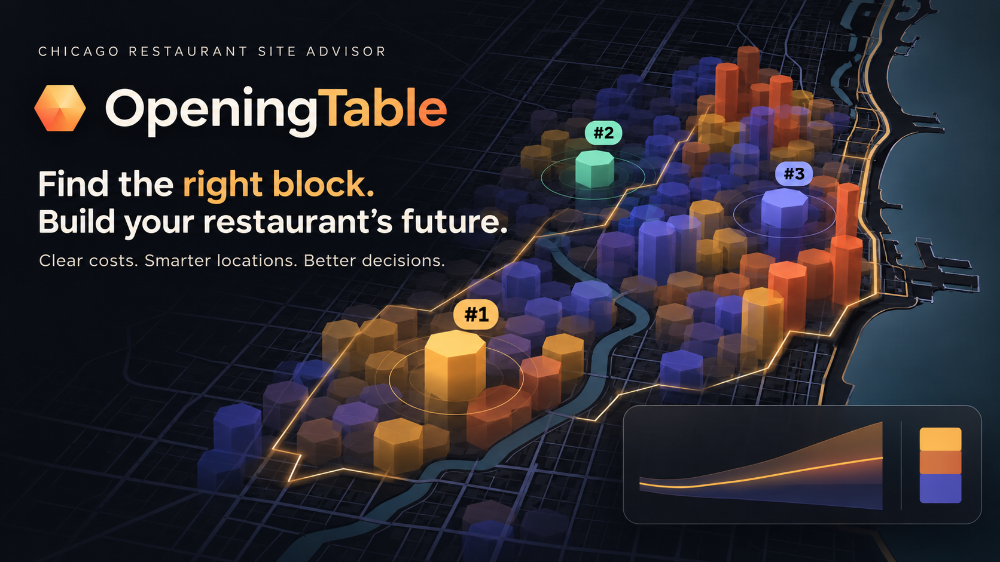
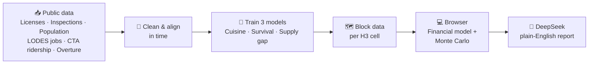

<p align="center">
  
</p>

<p align="center">
  <b>Find the right block. Build your restaurant's future.</b><br>
  A site advisor for independent restaurants in Chicago, built entirely on public data.
</p>

<p align="center">
  <a href="https://codespaces.new/michael333-xlin/chicago-restaurant-site-advisor"></a>
  &nbsp;
  <a href="https://render.com/deploy?repo=https://github.com/michael333-xlin/chicago-restaurant-site-advisor"></a>
</p>

<p align="center">
  
  
  
  
  
</p>

---

## What it does

Enter a **budget** and a **restaurant type**, pick a **ZIP**, and every block (H3 cell) on the map shows:

| 🏗️ Store size | 💵 Startup cost | 📊 Monthly P&L | ⏱️ Payback period | ⚠️ Risk |
|:---:|:---:|:---:|:---:|:---:|

Every number comes from public data and three trained models: a **cuisine classifier**, a **license survival model** and a **supply gap model**. Each site report opens with a plain-English summary written by DeepSeek, which explains the numbers but never invents them.

## Demo

<p align="center">
  <a href="https://youtu.be/V6KG62yBcaI">
    
  </a>
  <br>
  <sub>▶️ Click to watch on YouTube</sub>
</p>

## How it works



Models retrain every week and are **only promoted if they're no worse** than the current version; otherwise they roll back automatically.

> Methodology and validation: [advantage/README.md](advantage/README.md) · Product design: [docs/](docs/)

## Quick start

### Option 1 · Codespaces (free, nothing to install)

1. Click **Open in GitHub Codespaces** above, then **Create codespace**.
2. *(Optional)* Add `DEEPSEEK_API_KEY` on the creation page to enable the plain-English report.
3. The site opens in a new tab. First start shows **"Preparing data"** for ~5 minutes while it downloads data and trains models.

> If the tab doesn't open, go to **Ports** and click the 🌐 icon next to port 8000. Stop the codespace when done to save quota.

### Option 2 · Run locally

Requires **Python 3.11–3.14** and **Node 22**.

```bash
python3 -m venv .venv && .venv/bin/pip install -r requirements.txt
cd web && npm ci && npm run build && cd ..
ADMIN_TOKEN=devtoken .venv/bin/python -m uvicorn server.app:app --port 8000
```

Open http://localhost:8000. On first start the server downloads data and trains models in the background (~5 min, ~1.4 GB peak memory).

<details>
<summary>Run the pipeline manually / frontend dev mode</summary>

```bash
bash advantage/step0_download.sh                              # download data (~3 min)
.venv/bin/python advantage/agent_api.py retrain --no-download # train + export (~1.5 min)
```

For frontend work, run `cd web && npm run dev` and open http://localhost:5180 (proxies `/api` and `/data` to port 8000).
</details>

### Option 3 · Deploy to Render

Click **Deploy to Render** above. `render.yaml` creates a **Standard (2 GB)** instance with a 5 GB persistent disk and an auto-generated `ADMIN_TOKEN`. Add `DEEPSEEK_API_KEY` under **Environment** (optional), then wait until `/api/status` shows `"data_ready": true`.

> 💰 The Standard instance and disk are **paid**. 512 MB instances fail during training.

<details>
<summary>Weekly retraining & other platforms (Docker)</summary>

**Weekly retraining:** add these GitHub Actions secrets and `.github/workflows/weekly-refresh.yml` runs every Monday:

- `PLATEGAP_URL` — e.g. `https://plategap.onrender.com`
- `PLATEGAP_ADMIN_TOKEN` — the `ADMIN_TOKEN` from Render

*(Names still use `plategap`, the project's old name, to avoid breaking existing deployments.)*

**Any Docker host** (Railway, Fly.io, a VM):

```bash
docker build -t plategap .
docker run -p 8000:8000 -v plategap-data:/var/plategap \
  -e ADMIN_TOKEN=replace-me -e DEEPSEEK_API_KEY=your-key plategap
```
</details>

## Repository layout

```
web/            React + Vite + deck.gl frontend (financial model runs in the browser)
server/app.py   FastAPI backend: serves frontend, /data and /api
advantage/      Data pipeline, models, report writer, self-iteration
finance/        Financial parameters, rent research, neighborhood boundaries
data/seed/      Overture restaurant snapshot (needed on first start)
docs/           Product design docs, data source handbook
```

`data/` (~100 MB raw data) and `output/` (models + ~33 MB block data) are created at runtime and not committed.

## Configuration

| Variable | Default | Purpose |
|---|---|---|
| `ADMIN_TOKEN` | *empty* | Enables admin endpoints (retrain / export) |
| `DEEPSEEK_API_KEY` | *empty* | Enables the plain-English report |
| `DATA_DIR` / `OUTPUT_DIR` | `./data` / `./output` | Point to a persistent disk when deployed |
| `AUTO_BOOTSTRAP` | `1` | Auto download + train when no data exists |
| `PORT` | `8000` | Listening port (set automatically by Render) |

<details>
<summary>More variables</summary>

| Variable | Default | Purpose |
|---|---|---|
| `AS_OF` | Date of downloaded data | The "today" used for estimates |
| `VITE_DATA_BASE`, `VITE_API_BASE` | `/data`, `/api` | Only when frontend and backend are deployed separately |
</details>

## API

| Endpoint | Token | Description |
|---|:---:|---|
| `GET /api/status` | | Data readiness, job state, model version |
| `GET /api/recommend?budget=350000&cuisine=asian` | | Rank neighborhoods |
| `GET /api/survival?zip5=60614&cuisine=italian` | | 1,000-day license survival estimate |
| `POST /api/report` | | Plain-English report (needs `DEEPSEEK_API_KEY`) |
| `GET /api/tools` · `POST /api/tools/<name>` | some | Tool schemas for LLM agents |
| `POST /api/admin/retrain` | ✅ | Re-download data and retrain |
| `POST /api/admin/export` | ✅ | Re-export block data only |
| `GET /api/docs` | | Full interactive API docs |

Admin endpoints need `Authorization: Bearer <ADMIN_TOKEN>`. Write operations share a lock and return `409` while another job runs.

> ⚠️ `/api/report` is public and each call costs DeepSeek credits. Add access control on public deployments if needed.

## FAQ

<details>
<summary><b>Stuck on "Preparing data"</b></summary>

First start is still running. Check `/api/status`; if `job.state` is `error`, see `job.error`. Most common cause: less than 2 GB of memory.
</details>

<details>
<summary><b>"Report writer not configured"</b></summary>

Set `DEEPSEEK_API_KEY` on the server and restart.
</details>

<details>
<summary><b>Report lists numbers that "could not be traced"</b></summary>

DeepSeek used a number not in the model results. Ignore those; the model results below the report are authoritative.
</details>

<details>
<summary><b>Page broken or black after an update / basemap is black</b></summary>

Hard-refresh (Cmd+Shift+R). A black basemap means the browser can't reach `basemaps.cartocdn.com`; the hexagon layer still works.
</details>

## Data & limitations

**Sources:** [Overture Maps](https://overturemaps.org/) places · [Chicago Data Portal](https://data.cityofchicago.org/) (business licenses, food inspections, population, CTA ridership, ZIP boundaries, dry precincts) · [US Census LODES8](https://lehd.ces.census.gov/data/). Details in [docs/data_sources_chicago.md](docs/data_sources_chicago.md).

**Financial parameters** live in `web/src/model/benchmarks.json`, each with its source and derivation: 14 sourced, 20 partially sourced, 7 with no public source (flagged in the app's Assumptions table).

**Known limits:**
- Rent is ZIP-level; only 7 neighborhoods have researched rents, others use their median.
- Dry-precinct data is from 2011. Verify with BACP before signing a lease.
- No data on hotel rooms or student share.

<details>
<summary>How the plain-English report works</summary>

The web app packs the analysis into one structured payload (`web/src/model/narrativePayload.ts`). The server adds 45 cited Chicago reference facts (license fees, tax rates, lease conventions) and sends it to DeepSeek (`advantage/narrative.py`). The system prompt contains no numbers.

After the first draft, the server checks the structure and traces every number back to the payload. If anything fails, DeepSeek revises once; anything still untraceable is listed at the bottom. Results are cached (last 200 reports).
</details>

<details>
<summary>Self-iteration: how retraining decides to promote</summary>

`POST /api/admin/retrain` re-downloads data, retrains all models, and promotes the new version only if the production survival model's out-of-time Brier score beats the baseline, independent-restaurant AUC drops by ≤ 0.02, and classifier accuracy drops by ≤ 0.03. Otherwise it rolls back (`job.outcome: rolled_back`). Versions are tracked in `output/model_registry.json`; the last 5 are kept.
</details>

<details>
<summary>Tried and removed: live web data</summary>

We tested Exa web search across all 56 ZIPs (280 searches). Coverage was too thin and biased toward popular neighborhoods (no ZIP reached 3 verifiable rents), so it was dropped as a data source.
</details>
